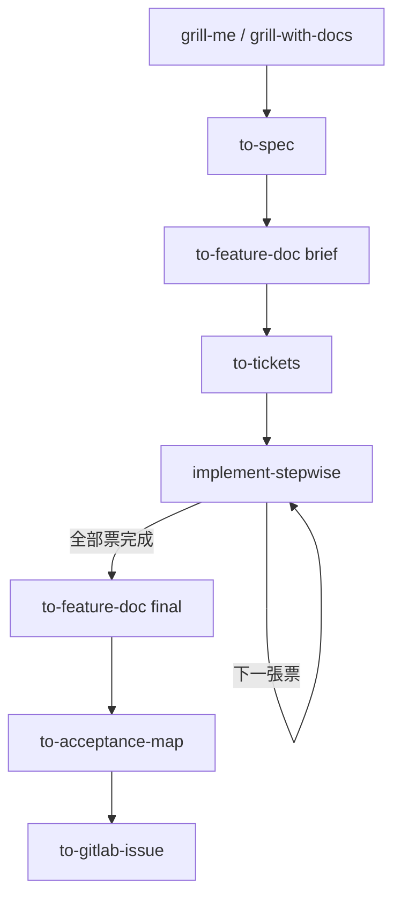
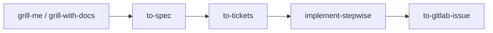
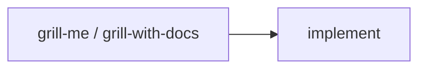

# support-matt

- 套件版本：`v0.37.0`
- 更新時間：2026-11-10
- 安裝教程：[INSTALL.md](./INSTALL.md)
<!-- 版本對齊 plugins/support-matt/.claude-plugin/plugin.json 與 .codex-plugin/plugin.json，發版時三處版本與此處日期一併更新 -->

---

## 介紹

> [!NOTE]
> 目前 Plugin 僅支持 **Claude Code** 與 **Codex** 安裝

強化 [Matt Pocock 的 skills](https://github.com/mattpocock/skills)，提供更完整的落地開發工作流與規格文件生成。

本 plugin 不取代 Matt 的任何 skill，需搭配該套 skill 使用。

## 目前收錄的 skill

| Skill | 用途 |
| --- | --- |
| `setup-matt-preset` | 以個人慣例初始化 Matt skills 的 per-repo 設定：local issue tracker、產物一律放 `.ai/`，並確認該 repo 的測試情境。取代直接調用 `setup-matt-pocock-skills`。 |
| `to-feature-doc` | **自己開發時**產出貼上主 Issue 的 `feature-doc.md`，分雙模式： • `brief`：拆票前跑，只寫約束（範圍、關鍵決策、驗證條件 `VC-xx`）。 • `final`：branch 做完跑，由既成事實組裝成以功能為主軸的文件。 |
| `to-handoff-doc` | **交給不使用 Matt 的人實作時**，在動工前一次寫出能開工的 `handoff-doc.md`，貼上主 Issue。章節骨架與 `final` 相同，另標明必須遵守的設計決策與可調整的實作方向。 |
| `implement-stepwise` | 取代 `implement`：單一 session 做完整張票，每個 commit 送出前停下等你過目，收尾驗證後停在定稿前，最後壓成一個票級 commit 並寫回 ticket。**不自動跑 Matt 的雙審 skill（`code-review`）**。 |
| `to-acceptance-map` | branch 開發完畢後於**獨立 session** 盤點測試覆蓋，產出 `acceptance-map.md`。驗證基準只認規格文件的 `VC-xx`，全程唯讀。 |
| `to-change-request` | 開發中途改動的**再入點**：討論或 grill 完接這一支，一次做完 `spec.md` delta、規格文件與未完成 ticket 的修訂。 |
| `to-gitlab-issue` | 把文件發布到**使用者指定 URL** 的主 Issue：`feature-doc.md` 或 `handoff-doc.md` 替換主內文，ticket 與 `acceptance-map.md` 各留言一則，缺的部分跳過。這是「GitLab 只讀」的明確例外，只能由使用者調用。 |

> `to-feature-doc` 與 `to-handoff-doc` 的選擇只看由誰實作，與改動大小無關。

> 不需要逐 commit 過目時，改用 Matt 原生的 `implement`。

## 工作流

每個 repo 第一次使用前跑一次 `setup-matt-preset`。

### 完整流程

> 建議所有票做完後，先跑一次本地 code review（不是 Matt 的雙審 skill）再進 `to-feature-doc final`，這樣修正能一起反映在文件裡，不必事後回頭改。

### 交給別人實作

### 開發中途要改

### 其他走法

本 plugin 的設計與 Matt 的工作流一致，可依需求簡化流程，例如：

Issue 已有開發文件：

需求小到一個 context window 做得完（Matt 原生的最簡流程）：

> 本 plugin 的規劃需要落地開發紀錄，這條路不會留下 spec 與 ticket，不建議這樣省略。

## 實作規範

由四份 reference 提供（`plugins/support-matt/references/`），`implement-stepwise` 依階段各讀一次：

| Reference | 內容 |
| --- | --- |
| `token-discipline.md` | 探索優先序（圖譜優先）、三條防呆、回合數成本 |
| `implementation-rules.md` | TDD 三條覆寫、程式碼與註解規範、commit 格式、邊做邊記 |
| `testing-rules.md` | 測試層級（入場規則與成本歸屬）、Test Consolidation、重跑範圍 |
| `wrap-up-rules.md` | 收尾的驗證、跨層重複檢查、驗收條件判定、定稿前停點、冷眼審查的建議條件與執行、寫回 ticket |

## 待補

後續規劃中的 skill 與流程調整尚未定案，確定後補上。
